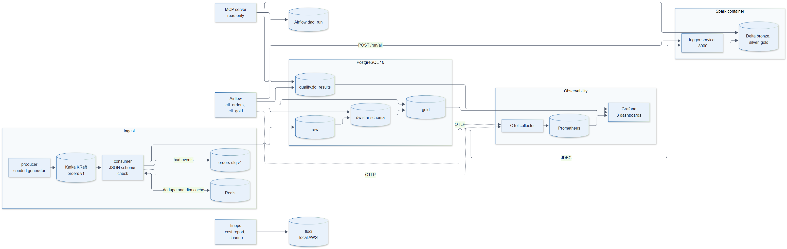
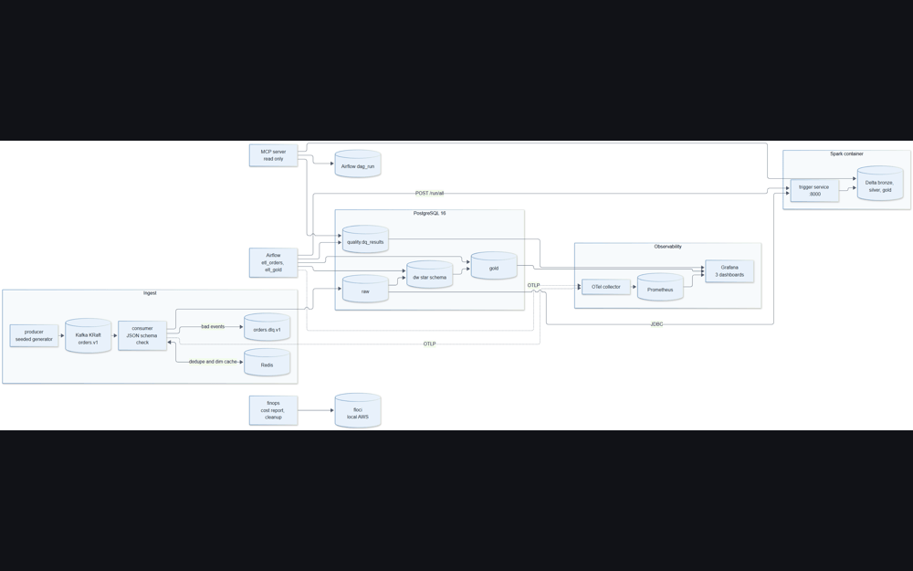
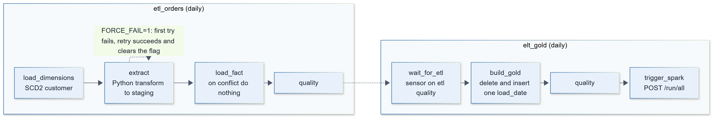
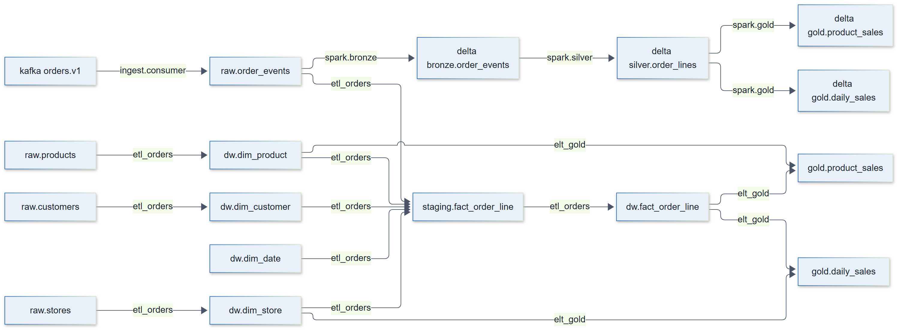

# Cloud Data Pipeline

[](https://github.com/siiick-brain/Cloud-data-pipeline/actions/workflows/ci.yml)

An end to end e-commerce data pipeline that runs on one laptop: streaming ingest, a Kimball star schema, a Delta lakehouse, orchestration with data quality gates, governance, dashboards, FinOps against an emulated AWS and a read-only MCP server for AI agents.





## The problem

A shop emits order line events all day. The business wants trusted daily sales numbers and the data team wants to prove that the numbers are right. That means no lost events, no double counting, bad records quarantined instead of silently dropped, every load safe to rerun and every number traceable to its source. It also has to fit in 4 CPUs and 8 GB of RAM.

## How to run

Needs Docker with Compose v2, GNU make and bash. [uv](https://docs.astral.sh/uv/) is only needed for the tests.

```bash
git clone <this repo> && cd cloud-data-pipeline
cp .env.example .env
make demo          # 100k events, about 9 minutes from a cold start
make demo-small    # 10k events, about 5 minutes from a cold start
```

`make demo` builds the images, waits for every service to be healthy, seeds master data, produces events and runs both DAGs. The first ETL try fails on purpose and the retry succeeds. Then it runs Spark, builds the FinOps report and prints a results block.

| What | Where (default ports, all bound to 127.0.0.1) |
|---|---|
| Grafana (admin and `GRAFANA_ADMIN_PASSWORD`) | http://localhost:3000 |
| Airflow (`AIRFLOW_ADMIN_USER` and password) | http://localhost:8080 |
| Prometheus | http://localhost:9090 |
| MCP server (bearer `MCP_TOKEN`) | http://localhost:8765/mcp |

If a port is taken on your machine, change `GRAFANA_PORT`, `AIRFLOW_PORT`, `PROMETHEUS_PORT` or `MCP_PORT` in `.env`. On Windows, Hyper-V can reserve 8765.

Other targets: `make up`, `make down`, `make seed`, `make test-unit`, `make test` (needs a running stack), `make lint`, `make audit` and `make drills`.

## What I built and why

| Part | What it does | Why this way |
|---|---|---|
| Data model (`sql/`) | Star schema with `fact_order_line`, SCD2 `dim_customer`, `dim_product`, `dim_store` and a pre-built `dim_date` | Integer surrogate keys and a -1 unknown member in every dimension, so a fact row never has a NULL key and foreign keys stay real constraints |
| Ingest (`ingest/`) | Seeded producer, consumer that validates against a JSON schema, dead-letter topic, Redis dedupe, replay tool | Offsets are committed only after the database commit, and the raw primary key is the final dedupe guard. Redis is the fast first filter |
| Lakehouse (`spark/`) | Bronze, silver and gold Delta tables, MERGE on event_id, time travel demo | A 60 line stdlib HTTP trigger service runs jobs in one reused SparkSession. No Docker socket and no JVM in the Airflow image |
| Orchestration (`dags/`) | `etl_orders` transforms in Python and loads staging, then the fact with `ON CONFLICT DO NOTHING`. `elt_gold` replaces one load date of gold in a single SQL transaction | Two different idempotency tools for two different load styles, both proven by running each DAG twice |
| Quality (`quality/`) | Nulls, uniqueness, referential integrity, row count reconciliation, freshness and schema checks | Results go to `quality.dq_results` and Prometheus. A broken rule fails the task and the build |
| Governance (`governance/`) | Catalog with owners and PII tags, generated lineage graph, retention with dry run default | The data dictionary CSV is the single source for the docs and the catalog table |
| Dashboards (`dashboards/`) | Sales, pipeline health and quality, all provisioned from JSON and YAML | No manual UI edits, so the dashboards are code reviewed like everything else |
| FinOps (`finops/`) | Cost report by service and tag from Cost Explorer and Budgets, idle resource cleanup | Runs against floci locally. Dry run is the default and `keep=true` resources are always skipped |
| Observability | OpenTelemetry in the consumer and DAG tasks, through the collector to Prometheus | One path for every metric, so there is one place to look when a number is missing |
| MCP server (`mcp/`) | Read-only tools `pipeline_status`, `dq_scores` and `gold_query` with allowlisted queries | Localhost bind, Origin check, constant-time token compare, audit log without secrets. See `docs/security/mcp-review.md` |

A plain-words tour of every component is in [docs/walkthrough.md](docs/walkthrough.md).

## Diagrams

| | |
|---|---|
| Star schema | 96,966 fact rows, 0 orphan foreign keys, raw and fact counts reconciled |
| DAG flow  | Lineage  |

The lineage graph is generated by `governance/lineage.py`. All diagrams are rendered in one style by `infra/render_diagrams.py`.

## Results

Measured on 2026-11-25 on a Windows 11 laptop with Docker Desktop (8 CPUs, 16 GB) while another monitoring stack was also running.

| Measure | Result |
|---|---|
| Cold start, every service healthy | 78 s to 174 s across runs (budget 180 s). The slow end was with another monitoring stack busy on the same machine |
| `make demo` 100k events, wall time including start | 559 s (budget 15 min) |
| `make demo-small` 10k events, wall time including start | 302 s, of which the demo itself took 181 s (budget 5 min) |
| 100k events in | 96,966 landed, 2,052 duplicates rejected by Redis, 982 malformed sent to the DLQ. 96,966 + 2,052 + 982 = 100,000 |
| Star schema | 96,958 fact rows, 0 orphan foreign keys, raw and fact counts reconciled |
| Quality checks failed | 0 |
| ETL forced failure | first try failed, retry succeeded, `FORCE_FAIL` cleared. 5 of 5 Airflow REST API checks pass after the run |
| Recovery drills | 4 of 4 pass, see [docs/recovery.md](docs/recovery.md) |
| Containers killed for memory | 0. Total cap 6.6 GB across 12 services |
| Tests | 173 host tests, 8 DAG tests, 11 Spark tests and 3 Grafana browser tests pass |
| Coverage | overall 97, ingest 96, quality 98, finops 97, mcp 100, dags 99, spark 96 (floors 80, 85, 85, 90, 85, 75, 70) |
| Security audit | 0 high, 0 medium across bandit, pip-audit, gitleaks, trivy and hadolint |

Peak memory during the final 100k demo, against each cap: webserver 360 of 500 MiB, Spark 983 MiB of 1.47 GiB, scheduler 633 of 1000 MiB, Kafka 506 of 800 MiB. Everything else stayed under 50 percent. An earlier run had the scheduler at 93 percent because the ETL extract held a whole day in memory. Extract now streams rows in batches of 5,000, which fixed the cause instead of raising the cap.

## Tradeoffs

- **Airflow 2.11, not 3.** Airflow 3 dropped task SLAs, which this project needs. The slim image cut startup from over 4 minutes to under 2.
- **Spark local mode in one container.** It is the only way to fit 1.5 GB. The jobs would run unchanged on a cluster. `spark/DATABRICKS.md` maps each piece to Databricks.
- **PostgreSQL gold and Delta gold side by side.** Grafana reads PostgreSQL. The MCP server reads Delta with the `deltalake` package so it needs no JVM. The same aggregation exists twice, which is the price of keeping both readers light.
- **load_date is the receive date.** Loads are partitioned by when data arrived, not when the sale happened, so late events land in the next partition instead of rewriting history.
- **floci for AWS.** It covers EC2, EBS, S3, Cost Explorer and Budgets with no account. It does not support snapshot create and delete, so the snapshot rule is proven in unit tests against the mock shape. `finops/README.md` shows how to point the same code at a real account.
- **Binary quality score.** A check passes or fails. A graded score would need per-check tuning that this data does not justify yet.

## Tests and checks

| Check | Command |
|---|---|
| Unit tests, no services | `make test-unit` |
| Integration, DAG, Spark and Grafana e2e tests | `make test` |
| Coverage floors (ingest 85, quality 85, finops 90, mcp 85, dags 75, spark 70, overall 80) | part of `make test` |
| ruff, mypy and bandit | `make lint` |
| bandit, pip-audit, gitleaks, trivy and hadolint | `make audit` |

## Repo layout

```
sql/          DDL, dim_date, unknown members, roles, SCD2 load
ingest/       generator, producer, consumer, DLQ replay, seed
spark/        Delta jobs, trigger service, time travel, Databricks notes
dags/         etl_orders, elt_gold, Airflow image
quality/      checks and runner
governance/   catalog, lineage, retention
dashboards/   Grafana JSON and provisioning
finops/       floci seed, cost report, cleanup
mcp/          read-only MCP server
infra/        collector and Prometheus config, Terraform, demo and drill scripts
docs/         contracts, diagrams, dictionary, recovery, walkthrough, security review
tests/        one folder per part
```
